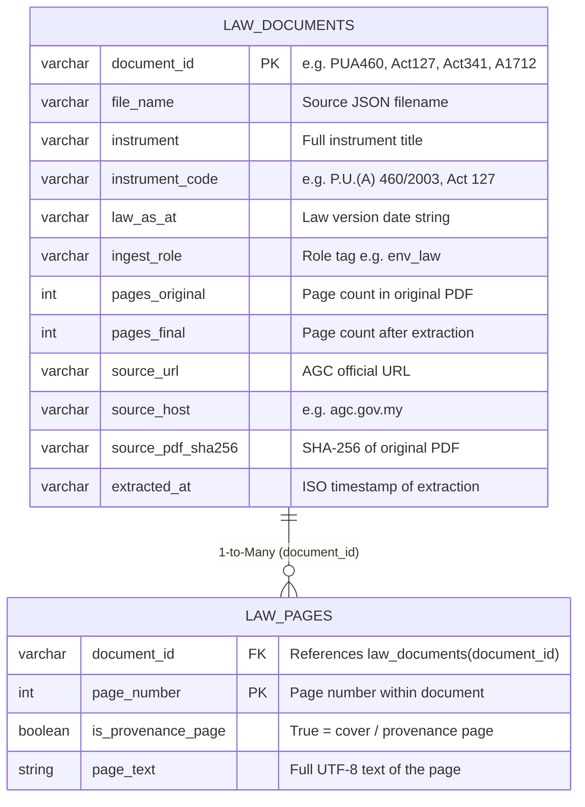

# Malaysia Law USL: Schema & Entity Relationships

Semantic legal data layer deployed in Zetaris (`malaysia_law_usl`), exposing 4 Malaysian environmental legal instruments and 130 full-text pages as a normalized **Document–Page** model.

---

## 1. Entity-Relationship Diagram (ERD)

---

## 2. Semantic Entities & Foreign Key Reference

| Table Name | Primary Key | Foreign Key / Target | Total Attributes | Purpose |
| :--- | :--- | :--- | :---: | :--- |
| **`law_documents`** | `document_id` (varchar) | — | 12 | 4 legal instruments — acts, orders, and amendments |
| **`law_pages`** | `(document_id, page_number)` (composite) | `document_id` → `law_documents(document_id)` | 4 | 130 full-text pages with provenance flags |

---

## 3. `law_documents` Column Reference

| Column | Type | Description |
| :--- | :--- | :--- |
| `document_id` | varchar(120) | Short unique key: `PUA460`, `Act127`, `Act341`, `A1712` |
| `file_name` | varchar(120) | Source JSON filename (e.g. `PUA460.json`) |
| `instrument` | varchar(255) | Full legal title of the instrument |
| `instrument_code` | varchar(50) | Official citation code (e.g. `P.U.(A) 460/2003`) |
| `law_as_at` | varchar(150) | Law version / gazette date string |
| `ingest_role` | varchar(50) | Classification tag (e.g. `env_law`) |
| `pages_original` | int | Total page count of the original PDF |
| `pages_final` | int | Page count successfully extracted |
| `source_url` | varchar(350) | AGC (Attorney General's Chambers) source URL |
| `source_host` | varchar(100) | Host domain (e.g. `agc.gov.my`) |
| `source_pdf_sha256` | varchar(64) | SHA-256 integrity hash of the source PDF |
| `extracted_at` | varchar(50) | ISO 8601 timestamp of extraction |

---

## 4. `law_pages` Column Reference

| Column | Type | Description |
| :--- | :--- | :--- |
| `document_id` | varchar(120) | FK to `law_documents.document_id` |
| `page_number` | int | 1-indexed page number within the document |
| `is_provenance_page` | boolean | `true` if page is a cover / provenance / title page |
| `page_text` | string | Full extracted UTF-8 text of the page |

---

## 5. Registered Legal Instruments

| `document_id` | `instrument_code` | Instrument | Role |
| :--- | :--- | :--- | :--- |
| `PUA460` | `P.U.(A) 460/2003` | Environmental Quality (Open Burning) Order 2003 | Environmental Regulation |
| `Act127` | `Act 127` | Environmental Quality Act 1974 | Primary Environmental Act |
| `Act341` | `Act 341` | Forestry Conservation Act | Forest Protection |
| `A1712` | `A1712` | Amendment to Environmental Quality Act | Amendment Order |
