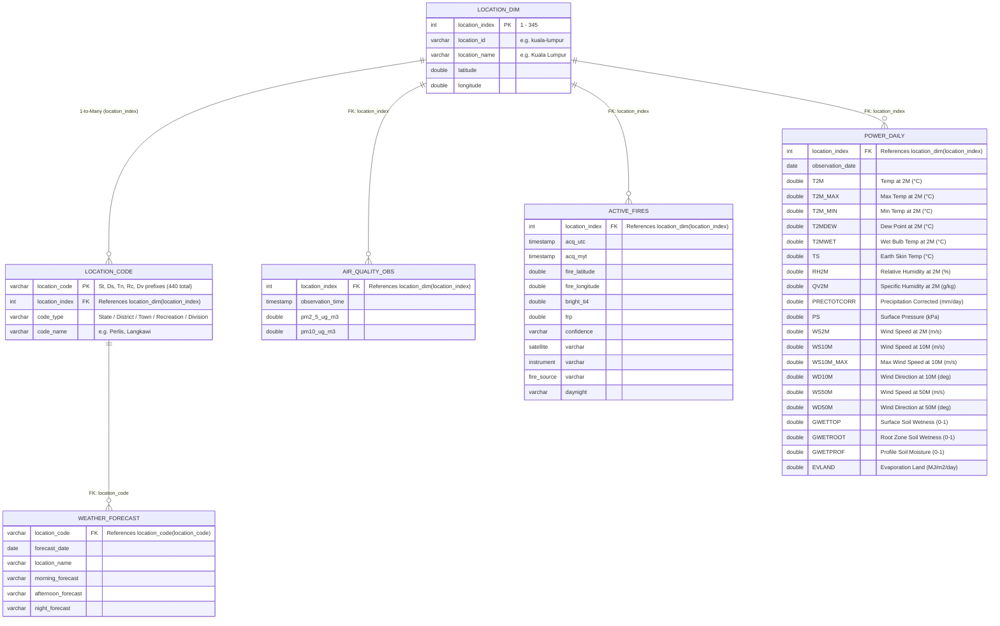

# Malaysia Environmental USL: Schema & Foreign Keys

Federated environmental intelligence layer deployed in Zetaris (`malaysia_env_usl`), unifying four live environmental data sources under a normalized **Location Dimension Model** across 345 canonical Malaysian locations.

---

## 1. Entity-Relationship Diagram (ERD)

---

## 2. Semantic Entities & Foreign Key Reference

| Table Name | Primary Key | Foreign Key / Target | Total Attributes | Purpose |
| :--- | :--- | :--- | :---: | :--- |
| **`location_dim`** | `location_index` (int) | — | 5 | 345 canonical centroid locations with lat/long coordinates |
| **`location_code`** | `location_code` (varchar) | `location_index` → `location_dim(location_index)` | 4 | 440 administrative forecast codes mapped to centroids |
| **`weather_forecast`** | *(composite on query)* | `location_code` → `location_code(location_code)` | 6 | Daily 7-day weather forecasts from Data.gov.my |
| **`air_quality_obs`** | *(composite on query)* | `location_index` → `location_dim(location_index)` | 4 | 120-hour hourly PM2.5 & PM10 from Open-Meteo |
| **`active_fires`** | *(composite on query)* | `location_index` → `location_dim(location_index)` | 12 | NASA FIRMS VIIRS satellite thermal hotspots |
| **`power_daily`** | *(composite on query)* | `location_index` → `location_dim(location_index)` | **22** (2 meta + **20 parameters**) | NASA POWER daily solar & climate variables |

---

## 3. NASA POWER 20 Parameters Specification

`power_daily` maps all 20 NASA POWER meteorological and surface parameters:

| Category | Parameter | Full Name | Unit |
| :--- | :--- | :--- | :--- |
| **Temperature** | `T2M` | Temperature at 2 Meters | °C |
| | `T2M_MAX` | Maximum Temperature at 2 Meters | °C |
| | `T2M_MIN` | Minimum Temperature at 2 Meters | °C |
| | `T2MDEW` | Dew/Frost Point at 2 Meters | °C |
| | `T2MWET` | Wet Bulb Temperature at 2 Meters | °C |
| | `TS` | Earth Skin Temperature | °C |
| **Wind** | `WS2M` | Wind Speed at 2 Meters | m/s |
| | `WS10M` | Wind Speed at 10 Meters | m/s |
| | `WS10M_MAX` | Maximum Wind Speed at 10 Meters | m/s |
| | `WD10M` | Wind Direction at 10 Meters | Degrees |
| | `WS50M` | Wind Speed at 50 Meters | m/s |
| | `WD50M` | Wind Direction at 50 Meters | Degrees |
| **Humidity & Moisture** | `RH2M` | Relative Humidity at 2 Meters | % |
| | `QV2M` | Specific Humidity at 2 Meters | g/kg |
| | `GWETTOP` | Surface Soil Wetness | 0 – 1 |
| | `GWETROOT` | Root Zone Soil Wetness | 0 – 1 |
| | `GWETPROF` | Profile Soil Moisture | 0 – 1 |
| **Precipitation & Land**| `PRECTOTCORR`| Precipitation Corrected | mm/day |
| | `EVLAND` | Evaporation Land | MJ/m²/day |
| **Pressure** | `PS` | Surface Pressure | kPa |
