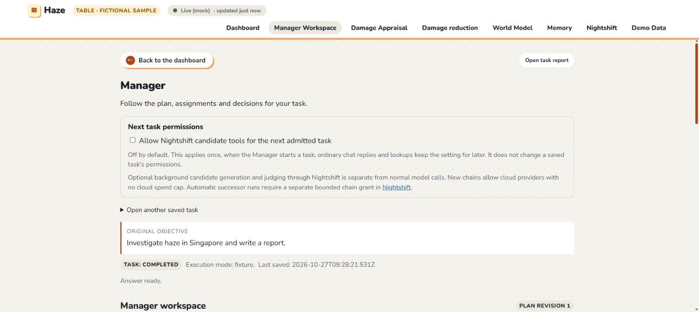

# Manager conversational routing: implementation and verification

Date: 2026-10-27

Plan: [Make the Manager conversational, with tasks when needed](../../plans/orchestration/manager-conversation-routing-plan.md)

## Result

The dashboard now sends messages to `POST /api/manager/chat`. The Manager chooses a conversational reply, a follow-up question, a read-only retrieval, task admission, or an answer to an existing task question. Ordinary chat no longer passes through task admission. Reports and investigations retain the existing durable task execution path.

Production conversation decisions use the configured Manager model route and a separate validated decision schema. The deterministic conversational model and synthetic collection source apply only in explicit fixture mode. Fixture answers label their evidence as synthetic.

## Changes

| Area                    | Implementation                                                                                                                                                                                                                                                                                                                                                                                                        |
| ----------------------- | --------------------------------------------------------------------------------------------------------------------------------------------------------------------------------------------------------------------------------------------------------------------------------------------------------------------------------------------------------------------------------------------------------------------- |
| Chat API contracts      | Added bounded request/response schemas in `app/contracts/manager-chat.ts`, including history, selected item, exact question identity, citations, error categories and one-use permission identity.                                                                                                                                                                                                                    |
| Conversation controller | Added `app/agents/manager/conversation.ts`, with conversation decisions independent of task planning. The composition layer supplies it through the neutral interfaces in `app/orchestration/conversation.ts`.                                                                                                                                                                                                        |
| Retrieval               | Reused World Model readers and the existing Open-Meteo, OpenAQ and FIRMS collection adapters. Added task-free governed readers in `TaskStore`; they check identity, execution mode, exact support artifacts, dependency access, current grants, applicability and acceptance lifecycle. No task or execution grant is created to retrieve conversational information.                                                 |
| Evidence                | Citation IDs must resolve to evidence retrieved during the turn. Source links, observation/retrieval times and observed/modeled/fixture labels come from server evidence. Unsupported model-generated links are rejected. Credential-bearing source URLs are removed before context reaches a model and before public citations are rendered.                                                                         |
| Bounds and failures     | Limited each turn to four retrieval operations and one model-output correction. Model/source waits honor cancellation and existing deadlines, including injected adapters that ignore their signal. The runtime caps the whole chat turn at 120 seconds. Model, malformed output, source, transport, task mutation conflict and task response failures remain conversational errors.                                  |
| Turn ledger             | Added `app/tasks/conversation-store.ts` on the task owner's existing SQLite connection. It binds conversation/turn identity to a request fingerprint and transport keys, persists the resolved decision, and commits task admission/update with its response receipt in one transaction. Duplicate delivery returns the same receipt; conflicting content receives HTTP 409. Internal diagnostics remain server-side. |
| Chat controller         | Added `useManagerConversation` and pure transcript helpers. Stored request payloads recover uncertain deliveries exactly. An explicit retry of a confirmed model/source failure starts a new turn. Independent polling observes task cards while the user keeps chatting. The latest selected task also feeds the existing office receipt observer.                                                                   |
| Transcript              | Preserved browser transcript storage and old text/report links. Stable task/question/result identities and revision guards suppress duplicates and stale results. A persisted event ledger prevents old questions/results returning after transcript trimming; task cards remain accessible.                                                                                                                          |
| Compact task cards      | Chat shows a task title, progress summary and **Open Manager workspace** link. Task admission and completion keep the dashboard open. Clarification questions appear once as Manager messages, with an explicit answer action.                                                                                                                                                                                        |
| Workspace controls      | Lifecycle controls, continuation, technical task details and permission revocation are owned by the Manager workspace. Report pages link there. The old chat control module remains a compatibility re-export.                                                                                                                                                                                                        |
| Next task permissions   | Moved the Nightshift checkbox into a labelled workspace setting, off by default. A persisted UUID identifies the grant. SQLite consumes it atomically with the first admitted task, so losing a response cannot apply it twice. Replies/lookups preserve the setting; a late response cannot clear a newer grant. Existing task revocation and revision checks remain authoritative.                                  |

Task admission ends the conversational operation immediately. Task questions use the existing clarification update path with exact task/question IDs and objective, run, generation and state revisions. A pending task question does not capture unrelated messages; ambiguous answers ask which task the user means.

Clearing chat creates a new conversation and detaches its old task selection. A persisted restoration boundary prevents late readbacks, workspace navigation and reload from importing the detached task back into the fresh transcript. Saved server tasks remain intact, and a new admission can be observed normally. The office keeps its canvas and agent statuses; its technical receipt and assignment blocks are replaced with a workspace link.

The existing task, artifact, report and World Model APIs remain available. Storage changes add conversation tables within the existing SQLite owner; no task-state migration, new data subscription or new provider integration is required.

## Verification

| Check                                              | Result                                                 |
| -------------------------------------------------- | ------------------------------------------------------ |
| `npm run typecheck`                                | Passed, including the separate Zetaris configuration.  |
| `npm run lint`                                     | Passed with zero warnings.                             |
| `npm run build`                                    | Passed; pinned engines vendored and backend compiled.  |
| `npm test`                                         | 109 suites, 1,326 tests passed.                        |
| `npm --prefix frontend run build`                  | Passed TypeScript and Vite production build.           |
| `npm --prefix frontend test`                       | 322 tests passed; one existing test skipped.           |
| Focused conversation/HTTP/ledger/World Model tests | 36 tests passed; 40 including runtime ownership tests. |
| Changed-file formatting and `git diff --check`     | Passed.                                                |

Backend tests verify greetings/explanations without admissions; missing location and lookup follow-up; configured Manager routing; evidence-backed citations; invalid citations; malformed output with one correction; four retrieval operations; unavailable sources; transport errors; cancellation; historical coverage gaps; unrelated questions while a task waits; ambiguous task answers; exact clarification updates; one-use permission consumption; concurrent retry/restart idempotency; and rollback if response validation fails after attempted admission.

Frontend tests cover compact chat rendering, retained historical text, current question/result reconciliation, stale revision guards, long-transcript reload deduplication, bounded history, exact retry payloads, protocol versus transport failures, task observer integration and permission identity/consumption behavior.

Browser verification used explicit fixture mode and isolated local state. It confirmed greeting/explanation replies, a missing-location follow-up followed by cited synthetic Singapore information, a report task admitted without leaving the dashboard, completed progress and a single result surviving reload, office task observation, the workspace link, and an unchecked Next task permissions setting in the workspace. Clear chat was checked after workspace navigation and again after reload: the transcript stayed fresh, the old server task remained completed, and a new task could be admitted. A clean page after the final restoration fix reported no browser errors. The final office presentation change also passed its 17 focused tests.

## Evidence limits

- Live model inference, live source availability and real Nightshift execution were not exercised in this verification. Automated tests cover route selection, source contracts and failure handling with fixtures/injected adapters; they do not certify live provider quality or access.
- Quick live adapters currently supply current snapshots. Explicit historical or future intervals that cannot be served return a coverage limitation instead of presenting current data as that interval. Retained World Model evidence can still be retrieved when available and authorized.
- Location resolution uses the existing configured location catalogue. Ambiguous or unsupported locations receive a conversational follow-up; the controller does not invent coordinates.
- Citation validation establishes that the cited evidence was retrieved and that its metadata is genuine. It does not independently prove every natural-language claim made by a model.
- Browser transcripts remain browser-local. The server ledger provides mutation/retry durability; it is not a cross-device transcript service.
